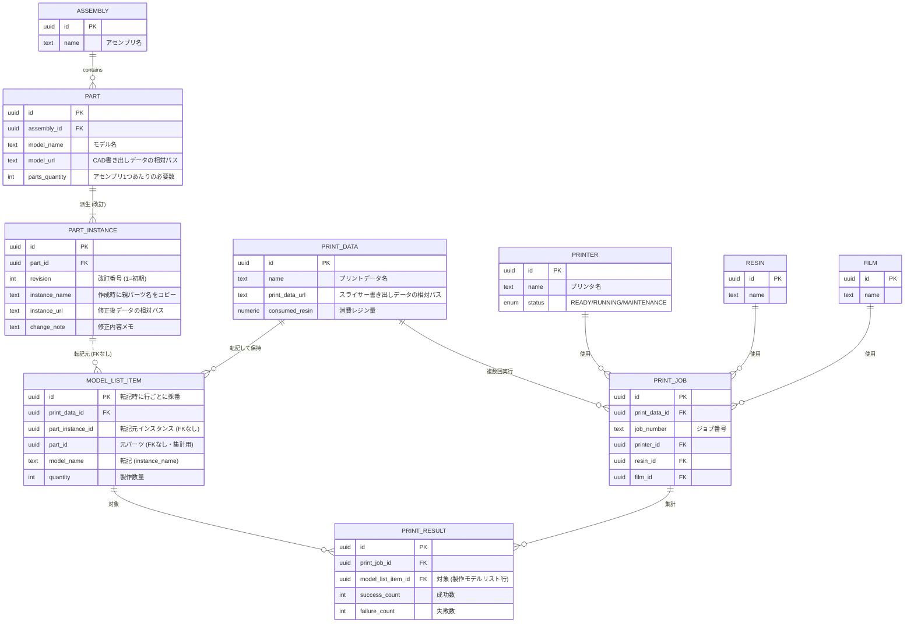

# データモデル定義書 (Draft)

> **改訂メモ (2026-10-24)**: ドメインモデルを再定義。旧「Project→Unit→Part→PartItem（かんばん式ステータス＋Box保管）」を廃止し、「アセンブリ→パーツ」と「プリントデータ→プリントジョブ→製作品（歩留まり集計）」を中心とするモデルへ全面改訂した。旧モデルは git 履歴を参照のこと。
> **改訂メモ (2026-10-25)**: 製作モデルリストの複合PKを廃止し、転記時に行ごとへ一意なUUIDを採番する形に変更。併せて、製作モデルリストは `print_data_id` をFKで持ち（`print_data.model_list_id` は廃止）、製作品は製作モデルリスト行を参照する形に変更した。
> **改訂メモ (2026-10-26)**: パーツから派生する `パーツインスタンス`（製作用に修正したデータ。設計の修正変更を改訂番号付きで記録）を新設し、製作モデルリストの転記元をインスタンスに変更した。併せて `parts.status`（`PartStatus`）を廃止し、`parts.parts_quantity`（アセンブリ1つあたりの必要数）を追加した。
> 本書は実装（`src/shared/db/schema.ts`）に先行する。実装との差分は別タスクで解消する。
> 「9. 未決事項」に確認待ちの論点を集約している。**暫定扱いの記述は本書内で「(暫定)」と明示**する。

## 1. 設計方針

本システムは、光造形3Dプリントの製造において「**何のデータを、どの設備・材料で、何回印刷し、どれだけ成功したか**」を記録し、歩留まりを把握するためのものである。データモデルは次の2つの文脈で構成する。

- **設計側 (CAD)**: CADから書き出したモデルを `アセンブリ → パーツ` の2階層で保持する。パーツは概念的なモデルで、製作用に修正したデータは `パーツインスタンス` としてパーツから派生させ、改訂番号付きで保持する（設計の修正変更の記録）。
- **製造側 (Print)**: プリントデータ（スライサーでモデル配置・サポート生成した結果のエクスポート）を単位に、ジョブを複数回実行し、結果を製作品として集計する。

設計側と製造側は**外部キーで結ばない**。製造側は、プリント時点の**パーツインスタンス**の情報を `製作モデルリスト` へ**転記**（スナップショット）して保持する。これにより、CADデータの差し替え・削除が過去のプリント記録に影響しない。

### 1.1 論理名と物理名の対応

| 日本語名 | 論理名 | 物理テーブル名 (案) | 文脈 |
| :--- | :--- | :--- | :--- |
| アセンブリ | ASSEMBLY | `assemblies` | 設計 |
| パーツ | PART | `parts` | 設計 |
| パーツインスタンス | PART_INSTANCE | `part_instances` | 設計 |
| プリントデータ | PRINT_DATA | `print_data` | 製造 |
| 製作モデルリスト | MODEL_LIST_ITEM | `model_list_items` | 製造 |
| プリントジョブ | PRINT_JOB | `print_jobs` | 製造 |
| 製作品 | PRINT_RESULT | `print_results` | 製造 |
| プリンタ | PRINTER | `printers` | マスタ |
| レジン | RESIN | `resins` | マスタ |
| フィルム | FILM | `films` | マスタ |

## 2. エンティティ関係図 (ERD)

実線は外部キー、点線は**外部キーを張らない論理参照（転記）**を表す。

## 3. 型定義の方針

- **ID**: 全テーブルで `uuid`（DB側 `gen_random_uuid()` 、Drizzle の `defaultRandom()`）を採用する (暫定)。旧仕様の「UUID v7」は実装されておらず、時系列での並び替えは `created_at` で行うため v4 で足りる。→ 未決事項 11
- **転記テーブルの行ID**: 他テーブルから転記して作る行（`model_list_items`）は、転記のたびに**行ごとに新規UUIDを採番**して主キーとする。転記元の `part_id` や複合キーを主キーに流用しない。同じパーツを別のプリントデータへ転記しても行IDは重複せず、`print_results` は行IDを単一列のFKで参照できる。
- **パーツインスタンス（改訂）**: `part_instances` は改訂ごとの**追記専用**レコードとする。データを修正するたびに新しい改訂を追加し、修正前のデータ（`instance_url` の指すファイル）は上書き・削除しない。Storage 上のオブジェクトも不変として扱う。
- **Enum**: Postgres の `ENUM` 型として定義する。
- **タイムスタンプ**: 全テーブルに `created_at timestamp DEFAULT now() NOT NULL` を付与する (暫定)。期間別の歩留まり集計とトレーサビリティのため。→ 未決事項 14
- **URL列** (`model_url`, `print_data_url`): ストレージ上の**相対パス**を保持する（絶対URLは保持しない）。取得時に `StorageService` が一時的な閲覧URLへ変換する。
- **日本語名のカラム**: 物理名は英語の snake_case とし、日本語名は本書と UI 表示ラベルで対応づける。

## 4. Enum 定義

| Enum | 値 | 用途 |
| :--- | :--- | :--- |
| `PrinterStatus` | `READY`, `RUNNING`, `MAINTENANCE` | プリンタの稼働状態。制御は手動の強制変更のみ（自動遷移は現スコープ外） |

旧仕様の `ItemStatus` / `BoxStatus` / `ReasonCode` / `PartStatus` は**廃止**（11. 参照）。

## 5. テーブル詳細

### 5.1 設計側

**assemblies (アセンブリ)** — 旧 Project に相当する最上位の単位。

| カラム | 型 | NULL | 備考 |
| :--- | :--- | :--- | :--- |
| `id` | uuid | NOT NULL | PK |
| `name` | text | NOT NULL | アセンブリ名（草案では `uuid` となっていたが誤記と判断し text とした。→ 未決事項 1） |

**parts (パーツ)** — アセンブリに用いる概念的なモデル。実際はここから製作用にインスタンスとして調整をしたデータが派生する。

| カラム | 型 | NULL | 備考 |
| :--- | :--- | :--- | :--- |
| `id` | uuid | NOT NULL | PK |
| `assembly_id` | uuid | NOT NULL | FK → assemblies.id |
| `model_name` | text | NOT NULL | ファイル名から拡張子を除いたもの（旧 `part_number`） |
| `model_url` | text | NOT NULL | CAD書き出しデータの相対パス。`status` を廃止したため、登録完了時点で必須（Storage 保存の成功後に DB 登録する。→ `04_logic_api.md` の `ImportPipeline`） |
| `parts_quantity` | integer | NOT NULL | アセンブリ1つに対して必要なパーツ数。`> 0`。草案では `text` だったが数量のため integer とした（→ 未決事項 15） |

> `status`（`PartStatus`）は、現スコープでは製作ステータスの管理が不要なため廃止した。なお旧 `PENDING/ACTIVE` にはインポート時の DB/Storage 不整合対策の役割もあったため、代替として `ImportPipeline` を「ID採番 → Storage 保存 → DB トランザクションで登録、DB 失敗時は保存済みファイルを削除」の補償処理にする（→ 未決事項 9）。

**part_instances (パーツインスタンス)** — パーツから派生した、**製作用に修正したデータ**。設計の修正変更を、改訂番号付きの追記専用レコードとして記録する。パーツのインポート時に初期インスタンス（改訂 1、元データと同一）を自動作成し、以後、データを修正するたびに新しい改訂を追加する。製作側（製作モデルリスト）は常にインスタンスを転記元とする。派生は `parts` 直下のみで、インスタンスからインスタンスへの連鎖派生は持たない。

| カラム | 型 | NULL | 備考 |
| :--- | :--- | :--- | :--- |
| `id` | uuid | NOT NULL | PK |
| `part_id` | uuid | NOT NULL | FK → parts.id |
| `revision` | integer | NOT NULL | 改訂番号。初期インスタンスが `1`、以後 `+1`。`>= 1`。`(part_id, revision)` で UNIQUE |
| `instance_name` | text | NOT NULL | 作成時に `parts.model_name` をコピーする。以後は編集可（親パーツを改名しても追随しない）(暫定。→ 未決事項 17)。同名のインスタンスは改訂番号で区別し、画面では「名前 rev.N」と表示する |
| `instance_url` | text | NOT NULL | 修正後データの相対パス。初期インスタンスは `parts.model_url` と同じパスを指す（Storage のファイルは複製せず共有する (暫定。→ 未決事項 16)） |
| `change_note` | text | NULL | 修正内容のメモ（サポート追加、分割、公差補正など）。初期インスタンスは NULL |

> 草案（`prats instance` / `parts_id` / `NOTNULL`）の表記は `part_instances` / `part_id` / `NOT NULL` に直した。草案の `instance_name`「ファイル名から拡張子を除く。ただし parts から継承した名前としたい」は、作成時に親パーツの名前をコピーする形で取り込んだ。
> 各パーツは必ず改訂 1 のインスタンスを持つ。これは `ImportPipeline` が保証する不変条件で、DB制約では強制しない。`instance_url` / `revision` / `change_note` は作成後に変更しない（→ 未決事項 17）。

### 5.2 製造側

**print_data (プリントデータ)** — スライサーでモデル配置・サポート生成を行った後にエクスポートしたデータ。プリントに使った最終データを保存できる唯一の手段であるため、**エクスポートしたファイルそのもの**を保持する。

| カラム | 型 | NULL | 備考 |
| :--- | :--- | :--- | :--- |
| `id` | uuid | NOT NULL | PK |
| `name` | text | NOT NULL | プリントデータ名 |
| `print_data_url` | text | **NOT NULL** | エクスポート済みデータの相対パス。**ジョブ作成時に必須**の決定に基づき、プリントデータはアップロード完了と同時に登録する（未アップロードのプリントデータは存在しない） |
| `consumed_resin` | numeric | NOT NULL | 消費レジン量。スライス後（エクスポート時）に判明する値。単位は未決（→ 未決事項 8） |

> 草案の `プリントデータ.パーツid` は製作モデルリストと冗長なため**削除** (暫定。→ 未決事項 3)。

**model_list_items (製作モデルリスト)** — プリントデータに含まれるモデルを縦持ちで保持する。パーツインスタンスからの**転記（スナップショット）**であり、パーツ・インスタンスへの外部キーは張らない。1プリントデータにつき1リストで、リストは使い回さない。プリントデータ登録のたびに、インスタンス1件につき1行を新規採番して作る。

| カラム | 型 | NULL | 備考 |
| :--- | :--- | :--- | :--- |
| `id` | uuid | NOT NULL | PK。転記時に行ごとに新規採番 |
| `print_data_id` | uuid | NOT NULL | FK → print_data.id |
| `part_instance_id` | uuid | NOT NULL | 転記元インスタンスのID。FKなしの参考値（改訂別の集計と、元データを辿るためのもの） |
| `part_id` | uuid | NOT NULL | 転記元パーツのID。FKなしの参考値（パーツ別の集計用） |
| `model_name` | text | NOT NULL | 転記時点のインスタンス名（`instance_name`）。パーツ・インスタンスの削除・改名後も記録を読めるようにする |
| `quantity` | integer | NOT NULL | 製作数量。`> 0` |

> 草案では `id` 1列がグループキーを兼ねていたが、行ごとに一意なUUIDを持つ形に改めた。プリントデータとの結合は `print_data_id` で行う（草案の `プリントデータ.モデルリストid` は廃止。→ 未決事項 2, 13）。

**print_jobs (プリントジョブ)** — プリントデータを、パラメータ（プリンタ・レジン・フィルム）を変えながら複数回印刷するための実行単位。

| カラム | 型 | NULL | 備考 |
| :--- | :--- | :--- | :--- |
| `id` | uuid | NOT NULL | PK |
| `print_data_id` | uuid | NOT NULL | FK → print_data.id |
| `job_number` | text | NOT NULL | UNIQUE。採番ルールは未決（→ 未決事項 12） |
| `printer_id` | uuid | NOT NULL | FK → printers.id |
| `resin_id` | uuid | NOT NULL | FK → resins.id |
| `film_id` | uuid | NOT NULL | FK → films.id |

**print_results (製作品)** — **ジョブ × 製作モデルリスト行（＝パーツインスタンス）単位の集計結果**。個体は識別しない。同名のパーツを複数枚印刷する運用があり、個々の個体の判別が困難なため、現スコープではジョブ単位の集計に留める。

| カラム | 型 | NULL | 備考 |
| :--- | :--- | :--- | :--- |
| `id` | uuid | NOT NULL | PK |
| `print_job_id` | uuid | NOT NULL | FK → print_jobs.id |
| `model_list_item_id` | uuid | NOT NULL | FK → model_list_items.id。対象のモデル行。当該行がジョブの `print_data_id` に属することはアプリ側で検証する（→ 未決事項 5） |
| `success_count` | integer | NOT NULL | 成功数。`>= 0`、既定 0 |
| `failure_count` | integer | NOT NULL | 失敗数。`>= 0`、既定 0 |

> 不良理由の分類（旧 `ReasonCode` 相当）は現スコープ外。必要になった時点で `print_results` に列を追加する。

### 5.3 マスタ

**printers (プリンタ)**

| カラム | 型 | NULL | 備考 |
| :--- | :--- | :--- | :--- |
| `id` | uuid | NOT NULL | PK |
| `name` | text | NOT NULL | プリンタ名 |
| `status` | PrinterStatus | NOT NULL | 既定 `READY`。手動の強制変更のみ |

**resins (レジン)** / **films (フィルム)**

| カラム | 型 | NULL | 備考 |
| :--- | :--- | :--- | :--- |
| `id` | uuid | NOT NULL | PK |
| `name` | text | NOT NULL | 名称。他の属性（メーカー・色等）は未決（→ 未決事項 8） |

## 6. リレーション

| 親 | 子 | 多重度 | 種別 |
| :--- | :--- | :--- | :--- |
| assemblies | parts | 1 : 0..N | FK (子側 NOT NULL) |
| print_data | print_jobs | 1 : 0..N | FK (子側 NOT NULL) |
| print_jobs | print_results | 1 : 0..N | FK (子側 NOT NULL) |
| printers / resins / films | print_jobs | 1 : 0..N | FK (子側 NOT NULL) |
| print_data | model_list_items | 1 : 1..N | FK (子側 NOT NULL) |
| model_list_items | print_results | 1 : 0..N | FK (子側 NOT NULL) |
| parts | part_instances | 1 : 1..N | FK (子側 NOT NULL)。各パーツは必ず改訂 1 を持つ |
| part_instances | model_list_items | 1 : 0..N | 転記（FKなし。`part_instance_id` は元インスタンスを辿る参考値） |

草案の `?<?` は DBML 標準にない表記のため、「親側1に対し子側0..N、子の親FKは NOT NULL」と解釈した (暫定。→ 未決事項 4)。

## 7. 歩留まりの定義

製作品の2つの数値と製作モデルリストの計画数から、次を算出する（保存せず、集計時に導出する）。

- **計画数**: `print_results.model_list_item_id` で `model_list_items.quantity` を直接 JOIN して取得する。
- **ジョブ×パーツの歩留まり** = `success_count / quantity`
- **ジョブ全体の歩留まり** = `Σ success_count / Σ quantity`（分母はジョブのプリントデータに属する全行の合計。結果が未登録の行も含む）
- **パーツ別／改訂別／プリントデータ別／期間別**は、上記を `model_list_items.part_id` / `part_instance_id` / `print_data_id` / `created_at` で集計する。改訂別の集計により、設計修正の前後で歩留まりがどう変わったかを比較できる。

`success_count + failure_count` と `quantity` の整合ルール（一致必須か、不一致を警告で許すか）は未決（→ 未決事項 7）。

## 8. インデックス・制約

- `print_data.print_data_url` は NOT NULL。
- `print_jobs.job_number` に UNIQUE 制約。
- `parts.parts_quantity > 0` の CHECK 制約。
- `part_instances` は `(part_id, revision)` に UNIQUE 制約、`revision >= 1` の CHECK 制約。「各パーツは改訂 1 のインスタンスを持つ」は、`ImportPipeline` がパーツと同一トランザクションで作ることで保証する（DB制約では強制しない）。
- `model_list_items` は PK `id`（行ごとに新規採番）、`quantity > 0` の CHECK 制約、`(print_data_id, part_instance_id)` に UNIQUE 制約（同一インスタンスは1行にまとめ、数量で表す。同一パーツの別改訂は別行として同じプリントデータに入れられる。暫定）。
- `print_results` は `(print_job_id, model_list_item_id)` に UNIQUE 制約（1ジョブ・1モデル行につき1レコード）、`success_count >= 0` かつ `failure_count >= 0` の CHECK 制約。
- `print_results.model_list_item_id` が指す行の `print_data_id` が、ジョブの `print_data_id` と一致することは**アプリ側（`JobResultRecordingPipeline`）で検証**し、DB制約では強制しない。
- `print_jobs.print_data_id`, `print_results.print_job_id`, `model_list_items.print_data_id`, `part_instances.part_id` にインデックス（歩留まり集計・改訂履歴表示の高速化）。
- `printers.status` にインデックス（稼働状況の一覧表示）。
- 外部キーの削除時動作 (暫定。→ 未決事項 18):

| 親 → 子 | `ON DELETE` | 理由 |
| :--- | :--- | :--- |
| assemblies → parts → part_instances | `CASCADE` | 設計側は転記方式のため、削除しても製造側の記録は壊れない |
| print_data → model_list_items | `CASCADE` | リストはプリントデータに属する |
| print_jobs → print_results | `CASCADE` | 誤登録したジョブを結果ごと削除できるようにする |
| print_data → print_jobs | `RESTRICT` | ジョブが残るプリントデータは削除不可 |
| model_list_items → print_results | `RESTRICT` | 結果が参照している行は削除不可 |
| printers / resins / films → print_jobs | `RESTRICT` | ジョブが参照するマスタは削除不可 |

Storage 上のファイルは削除に連動させず、DB から参照されなくなったものを定期クリーンアップで削除する。
- `parts` の `(assembly_id, model_name)` ユニーク制約は、再インポート（CADデータの改版）を `part_instances` の新しい改訂として扱うか、新規パーツとして扱うかの方針が決まってから判断する（将来拡張）。

## 9. 未決事項

ユーザー確認が必要な論点と、本書での暫定扱い。

| # | 論点 | 草案の状態 | 本書での暫定扱い |
| :--- | :--- | :--- | :--- |
| 1 | `アセンブリ名` の型 | `uuid` | 誤記とみなし `text` |
| 2 | `製作モデルリスト` のキーと転記列 | `id` 1列（グループキーとして重複） | **確定 (2026-10-25)**: 複合PKは使わず、転記時に行ごとに一意なUUID（`id`）を採番して PK とする。転記列は `part_instance_id`・`part_id`（いずれもFKなし）と `model_name`（2026-10-26 に転記元をインスタンスへ変更） |
| 3 | `プリントデータ.パーツid` | モデルリストと冗長 | 削除。残す場合は「代表パーツ」と定義する |
| 4 | `?<?` の意味 | DBML標準外 | 子側0..N、子の親FKはNOT NULL |
| 5 | 製作品の対象パーツの持ち方 | 列なし（製作品はジョブIDのみ） | **確定 (2026-10-25)**: `model_list_item_id` で製作モデルリスト行をFK参照する（`part_id` 列は持たない）。行がジョブのプリントデータに属することのみアプリ側で検証 |
| 6 | ジョブの進行状態 | 列なし | **未採用**。プリンタ `RUNNING` を意味づけ、結果記録のタイミングを定義するには `started_at` / `finished_at`（または status）が必要。採用するか要判断 |
| 7 | 成功数＋失敗数 と 製作数量 | 規定なし | 未規定。一致必須／超過・不足は警告のみ、のいずれか |
| 8 | マスタ属性・消費レジン量の単位 | `id` のみ／単位なし | プリンタ・レジン・フィルムは名称のみ。単位（mL か g）は未定 |
| 9 | パーツの `PENDING/ACTIVE` | 草案に status なし | **確定 (2026-10-26)**: 廃止（現スコープで製作ステータス管理が不要なため）。インポート時のDB/Storage不整合対策は、ID採番→Storage保存→DBトランザクション登録→DB失敗時に保存済みファイルを削除、の補償処理で代替する |
| 10 | アセンブリ・パーツの別スキーマ化 | 「別スキーマでもよいかも？」 | 転記方式と相性が良いため分離案。最終判断は `05_architecture.md` |
| 11 | ID方針 | 草案に記載なし | 現行実装に合わせ v4。旧仕様の「UUID v7」は撤回 |
| 12 | `ジョブ番号` の採番 | `text` のみ | UNIQUE とするのみ。採番ルール（連番／日付ベース／手入力）は未定 |
| 13 | `モデルリストid` の要否 | `製作モデルリスト.id > プリントデータ.モデルリストid`（リスト行→プリントデータは多対1） | **確定 (2026-10-25)**: `print_data.model_list_id` を廃止し、`model_list_items.print_data_id` をFKとする。1プリントデータにつき1リストで、リストの使い回しは想定しない（リストは草案の多重度どおり1プリントデータにのみ属するため、`model_list_id` は `print_data_id` と等価だった） |
| 14 | `created_at` の付与 | 草案に時刻列なし | 全テーブルに付与（期間別集計用） |
| 15 | `parts_quantity` の型・名称・用途 | 型 `text`。「アセンブリに何個必要か」を保持 | 型は `integer`。名称は `parts` 内で冗長なため `required_quantity` 等への改名を提案（現状は草案の名称のまま）。用途は表示とプリントデータ登録時の数量の初期値まで。充足率の計算は現スコープ外 |
| 16 | 初期インスタンスの Storage ファイル | 記載なし | `parts.model_url` と共有（複製しない）。Storage 上のオブジェクトは不変とし、上書き・参照中の削除をしない |
| 17 | インスタンスの変更・削除 | 記載なし | 追記専用。`instance_url` / `revision` / `change_note` は作成後に変更しない。`instance_name` のみ編集可。削除は、製作モデルリストへ転記されていない場合のみ（運用ルール。FKなしのため DB では強制しない） |
| 18 | 外部キーの削除時動作 | 記載なし | §8 の表のとおり。設計側は `CASCADE`、製造側の参照とマスタ参照は `RESTRICT`（他の仕様書の削除操作はこれに従う） |

## 10. 旧モデルとの対応

| 旧 | 新 |
| :--- | :--- |
| Project | アセンブリ（名称のみ引き継ぐ） |
| Unit | 廃止（アセンブリが階層の役割を担う） |
| Part (`part_number`, `stl_url`, `status`) | パーツ (`model_name`, `model_url`, `parts_quantity`)。`status` は廃止 |
| PartItem | 廃止（個体を識別せず、製作品＝ジョブ×パーツの集計に置換） |
| Machine (`name`, `type`, `status`) | プリンタ (`name`, `status`)。`type` は保持しない（→ 未決事項 8） |
| 新規 | パーツインスタンス、プリントデータ、製作モデルリスト、プリントジョブ、製作品、レジン、フィルム |

## 11. 廃止した概念

次の概念は本改訂で仕様から削除した。実装・他の仕様書からも順次除去する。

- **後工程のステータス管理**: `ItemStatus`（READY / PRINTING / CUTTING / SANDING / INSPECTION / COMPLETED / SHIPPED / DISCARD / CANCELLED）による工程遷移、かんばん式ボード、`StatusHistory`、`ReasonCode`。
- **保管場所 (Box) 管理**: `Box` マスタ、`BoxStatus`、製造指示時の空きBox確保（排他制御）、出荷・廃棄時の自動解放。
- **個体 (PartItem) 単位の追跡**: 同名パーツの個体判別が困難なため、ジョブ×パーツの集計に留める。
- **パーツの登録状態管理**: `PartStatus`（`PENDING` / `ACTIVE`）。現スコープでは製作ステータスの管理が不要なため廃止。インポート時の DB/Storage 不整合対策は補償処理で代替する（→ 未決事項 9）。
